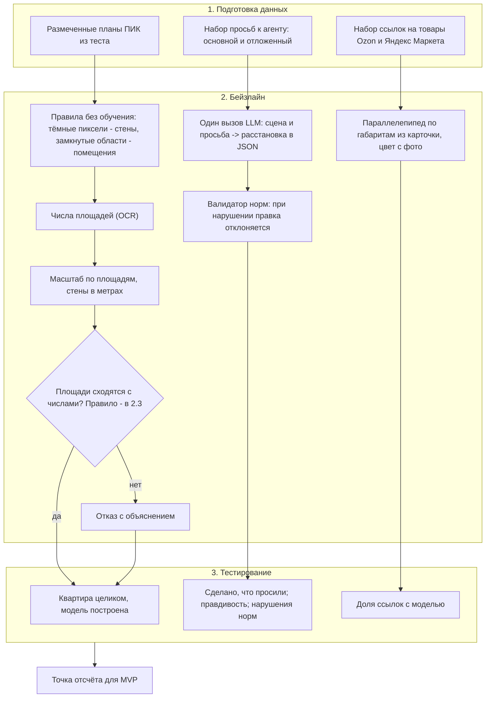
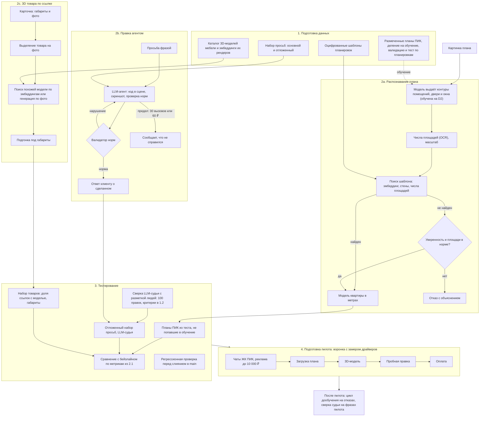

# Дизайн ML-системы - Своя планировка, MVP

> **Термины**
> - **Шаблон планировки** - заранее оцифрованная планировка: стены, двери, окна, комнаты в метрах.
> - **Нормы эргономики** - минимальные проходы и зазоры у мебели, свободное открывание дверей.
> - **Валидатор норм** - код, который проверяет расстановку на нарушения норм.
> - **LLM-судья** - LLM, которая по списку критериев оценивает результат правки агента.
> - **Отложенный набор** - тестовые сценарии, на которых не настраивают промпты и модели.
> - **Цех** - мастерская кухонь и шкафов на заказ.
> - **Стейджер** - специалист, который готовит квартиру к продаже или аренде: мебель, декор.
> - **Бейзлайн** - самое простое решение, с которым сравнивается MVP.
> - **Загрузка плана** - один человек и одна квартира. Повторная загрузка той же картинки тем же человеком не считается.
> - **Конверсия в оплату** - доля загрузок плана, после которых человек оплатил любой тариф.
> - **Пробная правка** - одна из трёх бесплатных правок агентом.
> - **Нижняя граница 95%-интервала** - нижняя граница доверительного интервала для доли, по формуле Уилсона. Учитывает, что на малой выборке измеренная доля неточна.
> - **Драйвер** - доля пользователей, прошедших шаг воронки. Показывает, на каком шаге они теряются.
> - **Защитная метрика** - показатель, который не должен ухудшиться, пока растёт главная метрика.
> - **Срез** - часть набора, по которой качество считаем отдельно. Например, студии.
> - **Регрессионная проверка** - проверка, что после изменения метрики не стали хуже.
> - **OCR** - распознавание напечатанного текста на картинке.
> - **Чертёж** - одна картинка планировки с разметкой. **Планировка** - группа чертежей одной и той же квартиры из разных домов.
> - **Каппа Коэна** - мера согласия двух оценщиков с поправкой на случайные совпадения: 1 - полное согласие, 0 - согласие на уровне случайного.
> - **Петля** - сторона, на которой дверь крепится к стене; от неё зависит, куда дверь открывается.
> - **Валидация и тест** - части набора, которые модель не видит при обучении: на валидации выбирают настройки, на тесте считают итог.
> - **Эмбеддинг** - вектор чисел, которым модель описывает картинку. У похожих картинок векторы близки.
> - **Аугментации** - искажения обучающих картинок (поворот, сжатие, изменение размера), которые делают модель устойчивее.

## 1. Цели и предпосылки

### 1.1. Зачем идём в разработку продукта

#### Бизнес-цель

Источник выручки - платные правки расстановки мебели. Клиент - покупатель новостройки. Между покупкой и заселением он планирует ремонт, расстановку и бюджет на мебель и технику.

Он загружает картинку планировки с сайта застройщика и получает 3D-модель квартиры в метрах с мебелью, расставленной по нормам. Дальше меняет расстановку обычной фразой и получает список мебели и техники с размерами и ценами.

Тарифы:

| Тариф | Цена | Что входит |
|---|---|---|
| Бесплатно | 0 ₽ | 3D-модель квартиры, правки мышью, 3 пробные правки агентом |
| Пакет | 490 ₽ | 10 правок агентом |
| Проект квартиры | 1 990 ₽ | 40 правок агентом, товары по ссылке, PDF со списком покупок |

Правки мышью бесплатны и не считаются. Если агент правку не выполнил, она не списывается. Оплаченные правки не сгорают.

#### Проблема и текущий процесс

От расстановки зависят розетки, кухня, шкафы и бюджет ремонта. До получения ключей квартиру обмерить нельзя, а на картинке застройщика есть только площади комнат: размеров стен и проёмов нет. После ключей обмер возможен, но перенос размеров в планировщик и расстановка занимают часы ручной работы. Поэтому планирование откладывают, делают на глаз или платят дизайнеру. Частота и стоимость ошибок при этом не измерены: это гипотеза, которую проверяет пилот.

Как человек решает задачу сейчас:

| Альтернатива | Что даёт | Чего не хватает | Цена |
|---|---|---|---|
| Рулетка и бумага | точные размеры после ключей | до ключей недоступна, нет 3D и проверки проходов | 0 ₽ |
| 3D-тур [ПИК](https://www.pik.ru/excursions/vr) или [Циана](https://www.cian.ru/stati-tsian-zapuskaet-samuju-krupnuju-bazu-3d-planirovok-na-rynke-novostroek-315543/) | квартиру в 3D у застройщика | своей расстановки, изменений, цен | 0 ₽ |
| [Planner 5D](https://planner5d.com/use/ai-room-design), [Planoplan](https://planoplan.com/ru/pricing), Remplanner | 3D и расстановку; Planner 5D распознаёт план | в Planoplan и Remplanner стены рисуются руками; точность распознавания Planner 5D на российских планах не проверена; проходы не проверяются | 0-3 590 ₽ в месяц |
| [ai.neiroset.com](https://ai.neiroset.com/ru/apartment-planner) | ИИ-расстановку с проверкой проходов | стены обводятся вручную | 1 259-4 859 ₽ в месяц |
| Дизайнер ([цены](https://profi.ru/remont/design/dizain-interiera/dizain-proekt/plan-pomesheniya/)) | 2-3 варианта расстановки с учётом норм | дорого и долго, до ключей работает по той же картинке без размеров | 150-1 700 ₽/м², для 50 м² 7,5-85 тыс. ₽, 1-2 недели |
| Цех кухонь | бесплатный эскиз кухни по плану застройщика | только кухня | 0 ₽ при заказе |

Данные о сервисах - октябрь 2026.

#### Почему станет лучше с ML

Три отличия от альтернатив:

1. **Не нужно разбираться в программах.** Человек пишет обычной фразой: "поставь кровать к окну", "добавь этот диван" со ссылкой на товар. Агент переставляет мебель и проверяет, что проходы и открывание дверей не нарушены. Сложное (кухню, всю комнату) делает агент, мелочи человек может подвинуть сам мышкой, проверка норм одна для обоих способов. В Planner 5D и Planoplan нужно освоить интерфейс, нарисовать стены и расставлять мебель вручную: у Planner 5D [2,5 из 5 на 200 отзывах](https://www.directline.pro/service/planner5d/otzyvy/), жалобы на сложное освоение.
2. **Точные метры по картинке плана застройщика.** До ключей квартиру не обмерить. Система находит оцифрованный шаблон планировки или оцифровывает картинку сама. Planner 5D тоже распознаёт план, поэтому наше отличие - точность на планах российских застройщиков. Свою точность меряем на тесте (2.3, этап 2). В этой итерации - только планы ПИК.
3. **Реальные товары магазинов в квартире.** По ссылке на товар Ozon или Яндекс Маркета система берёт из карточки габариты и цену и строит 3D-модель товара по фото: подбирает похожую готовую модель или генерирует форму, затем подгоняет под габариты. Из поставленных товаров складывается список покупок с ценами.

Без ML тот же результат дают:
- **дизайнер:** сам переносит план в 3D, расставляет мебель по нормам, подбирает товары. 7,5-85 тыс. ₽ за 50 м², 1-2 недели, каждая правка - через него;
- **3D-программы, где всё делает сам человек** (Planner 5D, Planoplan, Sweet Home 3D, SketchUp): рисует стены по картинке, расставляет мебель мышкой, вводит габариты товаров и сам следит за проходами. Нужно освоить программу, на квартиру уходят часы.

#### Что считаем успехом итерации

За месяц пилота не меньше 450 загрузок плана, и нижняя граница 95%-доверительного интервала конверсии в оплату не ниже 5%. Остальные метрики пилота - в разделе 1.2.

### 1.2. Бизнес-требования и ограничения

#### Бизнес-требования

Требования к трём функциям, которые определяют ML-часть:

**Распознавание плана.** На входе картинка планировки с сайта ПИК с подписанными площадями. На выходе стены, двери, окна и комнаты в метрах.

| Требование | Порог |
|---|---|
| Размеры верны: найдены все помещения, кроме балкона; площадь и длины стен каждого отличаются от настоящих не больше чем на 5% или 5 см | у 90% построенных моделей |
| Модель построена; в остальных случаях отказ, а не неверная модель | не меньше 80% загрузок |
| Время | до 3 минут в 90% случаев |

Точность проверяется на планах, для которых нет готового шаблона, в том числе на зеркальных и соседних планировках.

**Правка агентом.** Человек пишет просьбу обычной фразой, агент меняет расстановку.

| Требование | Порог |
|---|---|
| Сделано то, что просили, и ничего лишнего не сломано | не меньше 80% правок |
| Ответ агента о сделанном соответствует сцене | не меньше 80% правок |
| Нормы после правки не нарушены | всегда |
| Время | до 3 минут в 90% случаев |
| Стоимость | в среднем до 25 ₽ на правку; предел 60 ₽ и 30 вызовов LLM, при достижении предела агент сообщает об этом |

**3D-модель товара по ссылке** Ozon или Яндекс Маркета.

| Требование | Порог |
|---|---|
| Модель строится | для 90% ссылок, где в карточке есть размеры |
| Человек узнаёт товар | в 80% случаев |
| Габариты | как в карточке |
| Время | до 2 минут в 90% случаев |
| В карточке нет размеров | система сообщает, что поставить товар не может |

#### Бизнес-ограничения

- **Закон.** По 152-ФЗ в запросы к зарубежной LLM не передаются персональные данные: ФИО, адрес, номер квартиры. Фильтр проверяет всё, что уходит в LLM: текст просьбы, описание сцены и картинку плана. Телефон и полный адрес блокируют отправку, остальное маскируется. Полноту фильтра меряем на наборе с намеренно добавленными персональными данными.
- **Ответственность.** Результат - предварительное планирование, а не рабочий чертёж. Пользователь видит это предупреждение. Размеры для заказа кухни и встроенной мебели снимают обмером после ключей.
- **Деньги.** Инфраструктура своя: одна машина с GPU. LLM - в пределах API-кредитов $200 в месяц, реклама - до 10 000 ₽ за пилот.
- **Люди.** Систему ведёт один человек, ручной обработки квартир нет.
- **Охват.** Только новостройки с планировкой и подписанными площадями комнат на сайте застройщика. В этой итерации - только ПИК, план другого застройщика получает отказ.
- **Товары.** Карточки Ozon и Яндекс Маркета читаются по ссылке: их разметка меняется, доступ могут ограничить. При сбое клиент вводит габариты сам. Фото товара используется только для построения модели и клиенту не показывается.

#### Что ожидаем от итерации

- К старту пилота работает весь путь человека: загрузка плана -> бесплатная 3D-модель -> 3 пробные правки -> оплата -> правки фразой и вручную, товары по ссылке, прогулка, PDF.
- Три ML-функции измерены на тестовых наборах по критериям из бизнес-требований на планах ПИК; узнаваемость 3D-модели товара меряется на пилоте (1.3).
- Настроен сбор всех метрик из раздела "Что считаем успешным пилотом".
- LLM-судья сверен с оценками людей на 100 правках, из них не меньше 40 неудачных. На 50 правках настраиваем промпт судьи, на других 50 проверяем.
- Судья принимается, если его согласие с людьми (каппа Коэна) не ниже 0,6 и он пропускает не больше 20% неудачных правок. Иначе пробные правки пилота размечаются вручную после пилота; на работу сервиса это не влияет.

#### Процесс пилота

1. **Привлечение.** Посты в чатах ЖК ПИК, где дом сдаётся в ближайший год или ключи уже выдают. Если за 2 недели меньше 225 загрузок плана - реклама у блогеров про ремонт и новостройки в Telegram и VK и таргет в VK или Telegram Ads, общий бюджет до 10 000 ₽.
2. **Путь пользователя.** Загрузка плана -> бесплатная 3D-модель -> 3 пробные правки -> оплата пакета (490 ₽) или проекта (1 990 ₽) -> правки, товары, прогулка, PDF.
3. **Обратная связь.** После оплаты - короткий опрос из 2-3 вопросов. С 10-15 пользователями - интервью: что планировали, что купили, где ошиблись.
4. **Поддержка.** Вопросы пользователей разбирает владелец в Telegram.

#### Что считаем успешным пилотом

**Целевая метрика** - конверсия в оплату:

| Параметр | Значение |
|---|---|
| Единица | загрузка плана за месяц пилота: один аккаунт и одна картинка; повторная загрузка той же картинки не считается |
| Формула | загрузки, после которых оплачен пакет или проект / все загрузки |
| Окно | 14 дней после загрузки; загрузки последних двух недель досчитываются после пилота |
| Порог | нижняя граница 95%-интервала не ниже 5%. При 450 загрузках это 32 оплаты и больше |
| Владелец метрики | владелец продукта |

**Обоснование порога 5%.** Расчёт по верхней границе стоимости правки:

| Статья | Сумма |
|---|---|
| Стоимость правки агентом, верхняя граница | 25 ₽ |
| Стоимость пробных правок на одну загрузку плана | до 36 ₽ |
| Маржа с покупателя пакета: цена минус расходы на его правки | 240 ₽ |
| Маржа с покупателя проекта: цена минус расходы на его правки | 990 ₽ |

- Ниже 3,6% пробные правки не окупаются при любой доле проекта.
- При 5% окупаются, если проект выбирают 64% платящих.
- При ожидаемых 8,6% окупаются, если проект выбирают 24% платящих.

Поэтому 5% - нижняя граница. Фактическую окупаемость показывает защитная метрика «Доля расходов на LLM в выручке».

**Мощность пилота при 450 загрузках.** При истинной конверсии 8,5% порог будет пройден с вероятностью 88%, при 7,5% - с вероятностью 65%.

**Драйверы** - показывают, на каком шаге теряются люди:

| Драйвер | Формула | Ожидание |
|---|---|---|
| Модель построена | загрузки, по которым построена модель / все загрузки | 80% |
| Дошли до пробной правки | сделали пробную правку / получили модель | 60% |
| Оплатили после пробной правки | оплатили / сделали пробную правку | 18% |

Вместе это даёт ожидаемую конверсию 8,6% (0,8 x 0,6 x 0,18), выше порога 5%.

Для оценки экономики дополнительно считаем:

- долю проекта среди оплат (ожидание 30%);
- сколько пробных и оплаченных правок расходует пользователь;
- долю повторных покупок пакета.

**Защитные метрики:**

| Метрика | Формула | Порог |
|---|---|---|
| Доля расходов на LLM в выручке | расходы на LLM по ценам API за все правки, включая пробные / выручка | не выше 70% |
| Возвраты денег | попросили вернуть деньги / оплатили | не выше 5% |
| Пробная правка удалась | правки, где сделано то, что просили, по оценке LLM-судьи / все пробные правки | не ниже 80% |
| Правдивость агента | ответы о сделанном, правдивые по оценке LLM-судьи / все правки | не ниже 80% |

Точность размеров на пилоте не меряется: она оценивается офлайн, на тестовой выборке (2.3, этап 2).

**Жёсткое ограничение:** ни одного случая, когда в запрос к LLM попали персональные данные.

**Решение по итогам пилота:**

| Решение | Условие | Что дальше |
|---|---|---|
| Остановить | нарушено жёсткое ограничение; проверяем первым | пауза до исправления |
| Продлить | меньше 450 загрузок за месяц | пилот продлевается до 450 загрузок |
| Масштабировать | 32 оплаты и больше, защитные метрики в норме | больше каналов привлечения, аренда серверов, работа с цехами |
| Доработать | от 14 до 31 оплаты или нарушена защитная метрика | доработать шаг воронки с наибольшими потерями и повторить пилот |
| Закрыть гипотезу о продаже частным покупателям | 13 оплат и меньше | перейти к пути развития: цеха |

Числа оплат даны для 450 загрузок. При 32 оплатах нижняя граница 95%-интервала достигает 5%, при 13 оплатах верхняя граница опускается ниже 5%.

**Пути развития:**
- мебельные цеха: оплата за квартиру со скидкой за объём, изделия цеха в каталоге;
- брокеры новостроек, дизайнеры, стейджеры;
- вторичка с планами БТИ;
- подбор товаров системой под размеры места и предпочтения.

### 1.3. Что входит в скоуп итерации, что не входит

#### На закрытие каких бизнес-требований подписываемся

- **Распознавание плана** - с порогами из 1.2, только для планов ПИК: поиск шаблона среди оцифрованных планировок ПИК и оцифровка моделью, обученной на планах ПИК.
- **Правка агентом** - с порогами из 1.2.
- **3D-модель товара по ссылке** - в минимальном объёме: модель строится, габариты как в карточке. Узнаваемость товара (порог 80%) меряется на пилоте.

Без ML в итерацию входят стартовая расстановка по правилам, прогулка от первого лица, PDF со списком покупок и оплата.

#### Что не будет закрыто

- Планы застройщиков кроме ПИК: ни данных, ни распознавания для них в итерации нет.
- Порог узнаваемости 3D-модели товара - закрываем в следующей итерации по данным пилота.
- Подбор товаров системой под размер места и предпочтения.
- Магазины кроме Ozon и Яндекс Маркета.
- Вторичка: планы БТИ, сканы и фото планов.
- Продажи бизнесу: цеха, брокеры, дизайнеры, стейджеры, изделия цехов в каталоге.
- Партнёрские ссылки на товары.
- Работа больше чем на одной машине: дополнительные серверы и гарантии времени ответа при нагрузке выше пилотной.

#### Качество кода и воспроизводимость

- Код EDA, подготовки данных и оценки лежит в репозитории курса, проверяется ruff, pre-commit и pytest; версии зависимостей зафиксированы в `uv.lock`.
- Данные меняются только скриптами из репозитория. Деление на обучение, валидацию и тест воспроизводимо: порядок файлов и случайное зерно зафиксированы, результат записан в файл.
- Тестовые наборы (планы, просьбы к агенту, товары) хранятся вне git. У каждого есть паспорт: источник, автор и дата сборки, контрольные суммы файлов, версия разметки.
- Оценка каждой ML-функции запускается одной командой и сохраняет отчёт: версия модели и промпта, дата, метрики. Как воспроизвести - в README.
- Перед слиянием в main - регрессионная проверка на малом наборе: после изменения промпта или модели метрики из 1.2 не должны стать хуже.
- Отложенный набор правок не используется для настройки промптов.

#### Технический долг

- **Одна машина.** Резервной нет, при сбое сервис недоступен.
- **Сцена правки удерживает ресурсы машины, пока агент ждёт ответа LLM.** Ожидание занимает большую часть времени правки, поэтому число одновременных правок на одной машине ограничено.
- **Набор сценариев для агента** собирается на планах ПИК и на просьбах, которые пишет команда. Реальные фразы пилота добавляются после пилота.
- **LLM-судья сверен только на 100 правках, написанных командой.** На реальных запросах клиентов сверки нет, поэтому метрики пилота, которые считает судья, ориентировочные.
- **Нет автоматического цикла дообучения распознавания:** сбор отказов с пилота -> разметка -> дообучение -> регрессионная проверка -> замена модели. В итерации модель обучается один раз, вручную.

### 1.4. Предпосылки решения

| Предпосылка | Обоснование от бизнеса |
|---|---|
| Единица работы - одна квартира: один план, одна модель, одна расстановка | оба тарифа привязаны к квартире |
| Масштаб плана восстанавливается по подписанным площадям комнат | до ключей других размеров нет |
| Блоки данных: картинки планировок с сайта ПИК, оцифрованные шаблоны планировок, нормы эргономики, карточки товаров Ozon и Яндекс Маркета, каталог 3D-моделей мебели | человек приносит план и ссылки на товары |
| Нормы - жёсткие правила, а не то, чему модель учится | нарушение норм недопустимо: от расстановки зависят заказы мебели |
| LLM берём готовую, по API, сами не обучаем | в команде один человек, бюджет только на API-кредиты |
| Ответ в реальном времени: человек ждёт модель и правку | критерий - 3 минуты в 90% случаев |
| Цену правки считаем по ценам API, даже когда её покрывают бесплатные кредиты | иначе на пилоте затраты выглядят нулевыми, а при росте появятся |

## 2. Методология

### 2.1. Постановка задачи

Каждая ML-метрика привязана к бизнес-метрике из 1.2. В обозначениях курса: L3 - метрика модели, L2 - метрика шага пути пользователя, L1 - бизнес-метрика.

| Функция | Тип задачи | ML-метрики (L3) | Связь с бизнесом |
|---|---|---|---|
| **Распознавание плана** | 1) модель по картинке выдаёт контуры помещений, двери и окна; числа площадей читает OCR; масштаб по площадям; 2) поиск по изображению: если среди оцифрованных планировок есть совпадающий шаблон, он заменяет результат модели | квартира целиком (главная); модель построена; ошибка масштаба; тип помещения; двери и окна; шаблон найден верно; найден чужой шаблон. Пороги - в 2.3 | L2: драйвер «Модель построена» (не ниже 80%) -> L1: конверсия в оплату |
| **Правка агентом** | LLM-агент, который изменяет сцену кодом; нормы - жёсткие ограничения, их проверяет валидатор | доля правок "сделано, что просили"; правдивость ответа; нарушения норм - 0; стоимость и время правки | метрика качества "пробная правка удалась" и драйвер "оплатили после пробной правки" -> конверсия в оплату |
| **3D-модель товара по ссылке** | извлечение габаритов из карточки; выделение товара на фото; поиск похожей 3D-модели по эмбеддингам или генерация формы по фото; подгонка под габариты | доля ссылок с моделью; габариты как в карточке | товар в квартире -> список покупок с ценами -> защитная метрика "возвраты денег" |

### 2.2. Блок-схема решения

Бейзлайн и MVP различаются, поэтому схем две. Поиск шаблона у бейзлайна описан в 2.3, этап 3.

**Бейзлайн**

**MVP**

### 2.3. Этапы решения задачи

Этапы идут по блокам схемы MVP из 2.2:

| Этап | Блок схемы |
|---|---|
| 1. Подготовка данных | 1 |
| 2. Распознавание плана и 3. Поиск шаблона | 2a |
| 4. Агент правок | 2b |
| 5. Тестирование | 3 |

3D товара (блок 2c) ничего не обучает и здесь не описан. Все числа о данных взяты из `notebooks/eda.ipynb`.

#### Этап 1. Подготовка данных

**Какие данные есть**

| Данные | Объём | Откуда |
|---|---|---|
| Картинки планировок ПИК | 7 589 PNG, длинная сторона 1984 px | векторные чертежи ПИК, нарисованные как на pik.ru |
| Разметка | 7 589 JSON | строится автоматически из того же чертежа |
| Числа площадей на картинке | у каждого помещения | у 23% квартир с сайта ПИК, у остальных посчитаны по чертежу |
| Сценарии для агента | 154 в основном наборе, 60 в отложенном | написаны командой |

**Что модель выдаёт по картинке.** На входе у модели только картинка. Названий помещений на ней нет: тип модель определяет по нарисованной мебели и форме комнаты.

| Что | В каком виде |
|---|---|
| Помещения | контур и тип: комната, кухня, прихожая, санузел, гардеробная, прочее |
| Двери | отрезок вдоль стены, вид (межкомнатная, входная, проём), сторона петли |
| Окна | отрезок вдоль стены |
| Масштаб | метров в одном пикселе |

**Что показал EDA и что из этого следует**

| Наблюдение | Решение |
|---|---|
| Планировки повторяются: у 56% чертежей в наборе есть дубликат. Разных планировок 4 628 из 7 589 | все чертежи одной планировки попадают в одну часть выборки. Иначе у половины теста была бы копия в обучении |
| Разметка автоматическая, ручной проверки не было. У 14% квартир она неполная или расходится с числами на картинке | эти 1 045 квартир исключаем, остаётся 6 544. Большие квартиры исключаются чаще: 21% против 5% у студий |
| Балконные двери почти не размечены | двери на балкон модель не предсказывает |
| Проём без двери размечен как узкая дверь | дверь уже 0,6 м считаем проёмом |
| Балкон обведён целиком, а его площадь на сайте напечатана втрое меньше | балкон модель не предсказывает, в проверке площадей он не участвует |
| Шесть типов помещений дают 99% всех помещений | остальные объединяем в один тип «прочее» |
| Объекты мелкие: стена толщиной 15 пикселей, дверь от 64. Квартиры нарисованы в разном масштабе, разница до 2,5 раза | проверяем, что при уменьшении картинки двери и окна не теряются; при обучении меняем размер картинки |
| У 6,5% квартир (491 чертёж) есть косая стена или скошенный угол. У остальных все стены горизонтальные или вертикальные | после модели выравниваем только почти прямые стены; квартиры с косой стеной оцениваем отдельно |
| Площадь контура совпадает с числом с сайта у 99% помещений. Сумма площадей квартиры расходится с суммой чисел только у 0,6% квартир | по числам на картинке можно считать масштаб и проверять результат |
| Отдельное помещение расходится со своим числом больше чем на 5% в 10,1% квартир | отказ считаем по сумме площадей; для отдельного помещения допуск мягче: 5% или 0,3 м² |

Одной планировкой считаем чертежи с одинаковым числом помещений, у которых площади помещений (без балкона) отличаются не больше чем на 0,2 м². Условия фильтра - в ноутбуке, раздел 8.

Чего в наборе нет:

- половины планировок с косыми стенами (580 из 1 071), в том числе всех квартир с остеклённым эркером или панорамным углом;
- картинок клиентов;
- планов других застройщиков.

Ещё один известный дефект: у 4,9% комнат в контур попала площадка под кондиционер за фасадом. Число взято из журнала сборки набора, в ноутбуке оно не пересчитано.

**Косые стены.** У ПИК 1 071 чертёж с косой стеной. Формат шаблона описывает стены только по горизонтали и вертикали, поэтому раньше такие квартиры в набор не попадали. Для них сделана отдельная разметка, без шаблона.

| Что | Чертежей |
|---|---|
| Вошло в набор | 491 |
| Отброшено | 580 |

Почему отброшены (у одного чертежа причин может быть несколько):

- остеклённый эркер или панорамный угол: контур помещения на чертеже идёт не по стеклу - 359;
- масштаб не сходится с контурами больше чем на 5% - 181;
- у помещения нет контура - 145.

Двери и окна в разметке записаны отрезком вдоль стены: так их можно описать и на косой стене.

**Деление**

| Часть | Чертежей | Разных планировок |
|---|---|---|
| Обучение | 4 908 | 2 948 |
| Валидация | 818 | 492 |
| Тест | 818 | 493 |

- Доли студий, одно-, двух- и трёхкомнатных в частях одинаковые.
- Копий планировок теста в обучении нет.
- У 53% чертежей теста в обучении есть похожая планировка (площади отличаются до 0,5 м²): тест проверяет новые варианты типовых квартир ПИК, а не непохожие на них дома.

**Откуда берутся данные.** Скрипт проходит по чертежам ПИК: рисует картинку, строит разметку, подставляет числа площадей. Набор собран один раз. Когда у ПИК появляется новый ЖК, его добавляют тем же скриптом. Постоянного потока новых данных нет.

**Хватает ли данных.** Для квартир с прямыми стенами - да. Квартир с косой стеной после фильтра 453, в тесте 67: качество на них считаем отдельно.

| Что | Сколько | Вывод |
|---|---|---|
| Помещения шести основных типов, двери, окна | тысячи и десятки тысяч каждого | хватает |
| Прочие помещения | около 450 | объединены в один тип |
| Балконные двери | 108 | исключены из цели |

**Конфиденциальность.** Персональных данных в наборе нет. Картинки и разметка - материалы застройщика: в репозитории их нет, в ноутбуке несколько примеров. Картинки клиентов могут содержать адрес, с ними работаем по 1.2.

**Результат этапа**

- списки квартир после фильтра и деление на три части (`data/clean_codes.txt`, `data/split.csv`, вне git);
- срезы, по которым качество считаем отдельно: студии; 3 и больше комнат; 8 и больше помещений; редкие типы помещений; числа с сайта и с чертежа; мелкий и крупный масштаб; комнаты с площадкой под кондиционер; квартиры с косой стеной;
- ноутбук EDA в `notebooks/`.

#### Этап 2. Подготовка прогнозных моделей: распознавание плана

Задача: по картинке получить план квартиры в метрах. Модель обучается один раз, заново - только при изменении набора.

**Как проверяем**

- Варианты модели сравниваем на валидации по главной метрике.
- Тест используем один раз, для финального отчёта: целиком и по срезам.
- Деление одно, без кросс-валидации: обучение долгое, а 818 чертежей теста достаточно. При качестве 90% доверительный интервал около ±2 процентных пунктов.
- Главную метрику считаем дважды: по чертежам и по планировкам. Иначе планировка с десятью копиями весит в десять раз больше остальных.

**Метрики.** Ответ модели сравниваем с разметкой, а не с числом на картинке. Число уже используется в правиле отказа, и оценка по нему была бы завышена.

| Метрика | Как считаем | Порог на тесте | Зачем бизнесу |
|---|---|---|---|
| Квартира целиком (главная) | доля выданных моделей, где найдены все помещения, а площадь и длины стен каждого отличаются от разметки не больше чем на 5% или 5 см | не ниже 90% | 1.2: размеры верны |
| Модель построена | выданные модели / все квартиры теста | не ниже 80% | 1.2: модель получают 80% загрузивших |
| Ошибка масштаба | относительное отклонение масштаба от разметки | медиана не выше 2% | от масштаба зависят все размеры в метрах |
| Тип помещения | доля помещений с верным типом | не ниже 95% | от типа зависит стартовая расстановка |
| Полнота по дверям и окнам | доля размеченных дверей и окон, найденных моделью. Объект найден, если совпадает с разметкой не меньше чем на половину длины | не ниже 90% | по дверям проверяются проходы |
| Точность по дверям и окнам | доля найденных моделью дверей и окон, которые есть в разметке | не ниже 90% | лишняя дверь запрещает ставить мебель у стены |
| Сторона петли | доля найденных дверей с верной стороной петли | не ниже 90% | от неё зависит, куда открывается дверь |

**Бейзлайн и MVP**

Бейзлайн - правила без обучения. Они применимы, потому что картинки ПИК нарисованы в одном стиле: стены сплошные чёрные, фон светлый.

MVP - нейросеть, которая по картинке выдаёт последовательность объектов с координатами (подход Raster2Seq). Обучается на 4 908 чертежах, вход 512 x 512 пикселей.

| Что нужно получить | Бейзлайн: правила | MVP: обученная модель |
|---|---|---|
| Помещения | самые тёмные пиксели - стены; разрывы в стенах закрываются на ширину двери; замкнутые светлые области - помещения | модель выдаёт контур каждого помещения списком углов |
| Двери | разрыв в стене между двумя помещениями | модель выдаёт дверь отрезком: две точки |
| Окна | участок наружной стены, нарисованный тонкой линией | модель выдаёт окно отрезком: две точки |
| Тип помещения | не определяет | модель выдаёт тип вместе с контуром |

Пример ответа модели: «кухня: (120, 80), (460, 80), (460, 390), (120, 390); дверь: (300, 390), (380, 390)».

Дальше три шага, одинаковые для бейзлайна и MVP. Обучения в них нет.

1. **Сторона петли.** Определяем по дуге открывания, нарисованной рядом с дверью.
2. **Масштаб.** OCR читает числа площадей с картинки. Масштаб подбираем так, чтобы сумма площадей контуров совпала с суммой чисел.
3. **Отказ.** Модель квартиры не выдаём, если сумма площадей расходится с суммой чисел больше чем на 2% или одно помещение расходится со своим числом больше чем на 5% или 0,3 м². У MVP отказ ещё и тогда, когда модель сама не уверена в ответе.

Ограничения правил, из-за которых нужна модель:

- Кухня-гостиная и прихожая без стены между ними сливаются в одно помещение: на картинке их разделяет только пунктир.
- Тип помещения правилами не определить: по площади типы не различаются (EDA, раздел 4), а от типа зависит стартовая расстановка.
- На сжатом скриншоте клиента стены перестают быть однородно чёрными, и порог по яркости даёт ошибки.

Если правила дадут качество, близкое к порогам, обучение модели оправдано только существенным приростом.

**Функция потерь MVP.** Кросс-энтропия по элементам выходной последовательности: на каждом шаге модель предсказывает следующий элемент - тип объекта или координату. Координаты дискретизованы: модель выбирает узел сетки, а не предсказывает число.

Обоснование:

- одна функция потерь покрывает типы, координаты и число объектов;
- контур может иметь любое число углов, а у 71% помещений он не прямоугольный.

**Аугментации при обучении**

| Аугментация | Зачем |
|---|---|
| Поворот на 90° и зеркало | так отличаются копии планировок в наборе |
| Размер в 0,7-1,4 раза | масштаб в наборе разный |
| Сжатие JPEG и размытие | так выглядят скриншоты клиентов |

**Направления развития.** Более мелкая сетка координат, вход 1024 пикселя, другой порядок объектов в последовательности.

**Анализ ошибок.** Матрица ошибок по типам помещений; ошибка площади по срезам; ручной просмотр 50 худших квартир теста.

**Риски**

| Риск | Что делаем |
|---|---|
| Разрешения 512 пикселей может не хватить: один пиксель соответствует 2-5 см в квартире при допуске 5 см | координаты задаём с шагом мельче пикселя; при необходимости вход 1024 пикселя |
| У больших квартир последовательность длинная, и модель может её оборвать | максимальную длину берём по самой большой квартире набора; квартиры с 8 и больше помещениями оцениваем отдельно |
| Модель пропустит помещение или дверь | такие случаи отсекает правило отказа: площади не сходятся с числами |
| Правило отказа отклоняет и верные планы: даже эталонная разметка не проходит его в 6% квартир | допуск на помещение и порог уверенности подбираем на валидации так, чтобы «Модель построена» не опускалась ниже 80% |
| У 77% картинок число площади посчитано по той же разметке, с которой идёт сравнение. На них масштаб и доля отказов оптимистичнее, чем на реальных картинках | масштаб и отказы считаем отдельно по 23% квартир с числами сайта |
| Модель выучит ошибки разметки | проём сделан отдельным видом двери; балкон модель не предсказывает; комнаты с площадкой под кондиционер оцениваем отдельно |
| OCR неверно прочитает число | число, которое сильно выбивается из остальных, не учитываем |
| Скриншот клиента отличается от картинок набора | аугментации сжатием и изменением размера; на пилоте контролируем долю отказов |
| Квартир с косой стеной мало: 6,5% набора, в тесте 67. Разметка для них новая | оцениваем их отдельным срезом; доверительный интервал на 67 квартирах широкий. Пока качество на срезе ниже порога, таким квартирам отказываем |

**Результат этапа**

- модель с правилом отказа;
- отчёт на тесте: одни и те же метрики для модели и для бейзлайна на правилах;
- бизнес-проверка: владелец продукта просматривает 30 случайных квартир теста в 3D и сверяет каждую с исходной картинкой.

#### Этап 3. Поиск шаблона планировки

Планировки ПИК из набора уже оцифрованы. Шаблон содержит точные размеры, а модель даёт приближение, поэтому шаблон предпочтительнее. Модель этапа 2 запускается всегда; если среди шаблонов нашёлся совпадающий, вместо её ответа берём шаблон.

Сложный случай - соседние квартиры одного подъезда: картинки почти одинаковые, а стены отличаются на 10-20 см.

| Шаг | Бейзлайн | MVP |
|---|---|---|
| Отбор похожих | перцептивный хеш: короткий код картинки, у похожих картинок коды близки | эмбеддинг картинки от предобученной модели DINOv2; 10 ближайших шаблонов |
| Проверка | нет | две проверки: стены от модели этапа 2 совпадают со стенами шаблона в одном из 8 поворотов и отражений; числа площадей совпадают с точностью 0,5 м² |

**На чём проверяем**

| Что | Откуда берём |
|---|---|
| База шаблонов | планировки обучения и валидации |
| Запросы, для которых шаблон есть | картинки валидации, сжатые и обрезанные как скриншоты |
| Запросы, для которых шаблона нет | картинки теста: их планировок в базе нет |

Пороги подбираем на валидации. На это время половину её планировок убираем из базы, чтобы были запросы без шаблона.

**Метрики**

| Метрика | Порог | Почему |
|---|---|---|
| Шаблон найден верно | не ниже 95% запросов, для которых он есть | иначе база шаблонов не даёт выигрыша |
| Найден чужой шаблон | не выше 1% запросов | клиент получает неверные размеры без предупреждения |

**Результат этапа.** База шаблонов, пороги, отчёт. Обучения на этом этапе нет.

#### Этап 4. Агент правок

**Данные**

| Набор | Сценариев | Квартир | Для чего |
|---|---|---|---|
| Основной | 154 | 50 | настройка промптов и инструментов |
| Отложенный | 60 | 24 из разных ЖК, ни одной из основного | проверка; 10 категорий по 6 сценариев |

Результат правки проверяется автоматически, условиями по сцене: например, «кровать стоит у стены», «проход не меньше 70 см». В отложенном наборе 60 шагов:

| Шагов | Автоматических проверок |
|---|---|
| 48 | две и больше |
| 1 | одна |
| 11 | нет: верный ответ - вопрос клиенту или отказ |

Для 47 шагов заранее найдена расстановка, которая проходит проверки: просьбы выполнимы.

**Бейзлайн и MVP**

|  | Бейзлайн | MVP |
|---|---|---|
| Как работает | один запрос к LLM: сцена и просьба на входе, расстановка на выходе | агент в несколько шагов пишет код, который меняет сцену, смотрит результат и откатывается при неудаче |
| Нормы | валидатор отклоняет правку с нарушением | правка завершается только после проверки без нарушений |
| Если не получилось | правка отклонена | агент переспрашивает или отказывается с объяснением |

**Метрики**

| Метрика | Как считаем | Порог (1.2) |
|---|---|---|
| Сделано, что просили | автоматические проверки; где их нет - LLM-судья | не ниже 80% |
| Правдивость ответа | LLM-судья | не ниже 80% |
| Нарушения норм | валидатор | 0 |
| Время и стоимость | логи | 3 минуты в 90% случаев; 25 ₽ в среднем |

На пилоте автоматических проверок нет, первую метрику считает только судья. Поэтому её значения на пилоте и на отложенном наборе напрямую не сопоставимы.

**Как проверяем.** Отложенный набор прогоняем один раз, на финальной версии агента. Судья - LLM другого производителя, чем у агента: иначе модель оценивала бы саму себя. Сверка судьи с людьми описана в 1.2.

**Риски**

| Риск | Что делаем |
|---|---|
| Судья не пройдёт сверку с людьми | пробные правки пилота размечаем вручную после пилота |
| На одну категорию 6 сценариев | вывод делаем по набору целиком. На 60 сценариях при 90% успеха нижняя граница интервала около 80% |
| В 9 сценариях автоматические проверки выполняются уже на исходной сцене и изменение не фиксируют: состав кухни и ширину шкафа ими не выразить | итог этих сценариев оценивает LLM-судья |

**Результат этапа.** Агент, отчёт на отложенном наборе, логи стоимости и времени.

#### Этап 5. Тестирование и регрессионная проверка

Порядок запуска оценки и состав отчёта - в 1.3. Ниже - проверка перед слиянием в main.

| Что изменилось | На чём проверяем |
|---|---|
| Распознавание плана | 100 чертежей из валидации |
| Промпт или модель LLM | основной набор сценариев |

Старую и новую версии сравниваем на одних и тех же примерах. Изменение принимается, если:

- доля успешных упала не больше чем на 5 процентных пунктов;
- нарушений норм нет;
- время и стоимость укладываются в пороги 1.2.

Заменить модель распознавания можно только с полным отчётом на тесте.
