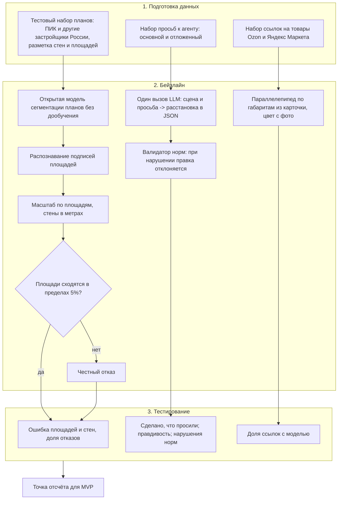
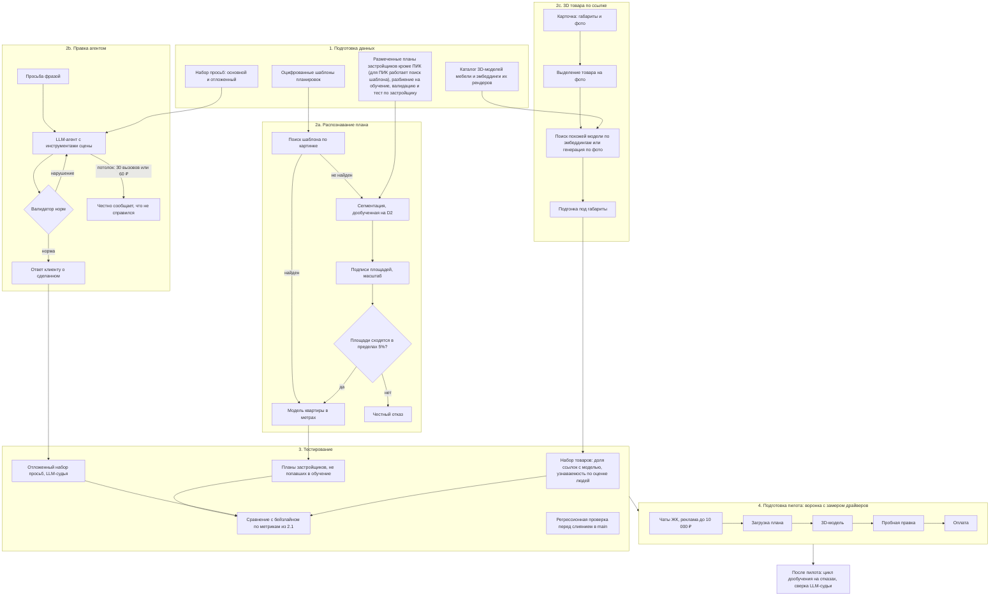

# Дизайн ML-системы - Своя планировка, MVP

> **Термины**
> - **Шаблон планировки** - заранее оцифрованная планировка: стены, двери, окна, комнаты в метрах.
> - **Нормы эргономики** - минимальные проходы и зазоры у мебели, свободное открывание дверей.
> - **Валидатор норм** - код, который проверяет расстановку на нарушения норм.
> - **LLM-судья** - LLM, которая по рубрике оценивает результат правки агента.
> - **Отложенный набор** - тестовые кейсы, на которых не настраивают промпты и модели.
> - **Цех** - мастерская кухонь и шкафов на заказ.
> - **Стейджер** - специалист, который готовит квартиру к продаже или аренде: мебель, декор.
> - **Бейзлайн** - самое простое решение, с которым сравнивается MVP.

## 1. Цели и предпосылки

### 1.1. Зачем идём в разработку продукта

#### Бизнес-цель

Выручка от продажи проектов квартир по 1 990 ₽. Платит покупатель новостройки в период от покупки до заселения, когда планирует ремонт, расстановку и бюджет на мебель и технику. По картинке планировки с сайта застройщика он получает 3D-модель квартиры в метрах с расстановкой по нормам, правит её фразой и получает список мебели и техники с размерами и ценами. Охват - новостройки России с планировкой и площадями на сайте застройщика.

#### Проблема и текущий процесс

От расстановки зависят розетки, кухня, шкафы и бюджет ремонта. До ключей квартиру не обмерить, а на картинке застройщика есть только площади комнат, без размеров стен и проёмов. После ключей обмер возможен, но перенос размеров в планировщик и расстановка - часы ручной работы. Поэтому планирование откладывают, делают на глаз или платят дизайнеру. Частота и цена ошибок не измерены, это гипотеза пилота.

Как человек решает задачу сейчас:

| Альтернатива                                                                                                                                                         | Что даёт                                    | Чего не хватает                                                            | Цена                                                |
| -------------------------------------------------------------------------------------------------------------------------------------------------------------------- | ------------------------------------------- | -------------------------------------------------------------------------- | --------------------------------------------------- |
| Рулетка и бумага                                                                                                                                                     | точные размеры после ключей                 | до ключей недоступна, нет 3D и проверки проходов                           | 0 ₽                                                 |
| 3D-тур [ПИК](https://www.pik.ru/excursions/vr) или [Циана](https://www.cian.ru/stati-tsian-zapuskaet-samuju-krupnuju-bazu-3d-planirovok-na-rynke-novostroek-315543/) | квартиру в 3D у застройщика                 | своей расстановки, изменений, цен                                          | 0 ₽                                                 |
| [Planner 5D](https://planner5d.com/use/ai-room-design), [Planoplan](https://planoplan.com/ru/pricing), Remplanner                                                    | 3D и расстановку; Planner 5D распознаёт план | в Planoplan и Remplanner стены рисуются руками; точность распознавания Planner 5D на российских планах не проверена; проходы не проверяются | 0-3 590 ₽ в месяц                                   |
| [ai.neiroset.com](https://ai.neiroset.com/ru/apartment-planner)                                                                                                      | ИИ-расстановку с проверкой проходов         | стены обводятся вручную                                                    | 1 259-4 859 ₽ в месяц                               |
| Дизайнер ([цены](https://profi.ru/remont/design/dizain-interiera/dizain-proekt/plan-pomesheniya/))                                                                   | 2-3 варианта расстановки с учётом норм      | дорого и долго, до ключей работает по той же картинке без размеров         | 150-1 700 ₽/м², для 50 м² 7,5-85 тыс. ₽, 1-2 недели |
| Цех кухонь                                                                                                                                                           | бесплатный эскиз кухни по плану застройщика | только кухня                                                               | 0 ₽ при заказе                                      |

Данные о сервисах - октябрь 2026.

#### Почему станет лучше с ML

Три отличия от лучших альтернатив:

1. **Не нужно разбираться в программах.** Человек пишет обычной фразой: "поставь кровать к окну", "добавь этот диван" со ссылкой на товар. Агент переставляет мебель и проверяет, что проходы и открывание дверей не нарушены. Сложное (кухню, всю комнату) делает агент, мелочи человек может подвинуть сам мышкой, проверка норм одна для обоих способов. В Planner 5D и Planoplan нужно освоить интерфейс, нарисовать стены и расставлять мебель вручную: у Planner 5D [2,5 из 5 на 200 отзывах](https://www.directline.pro/service/planner5d/otzyvy/), жалобы на сложное освоение.
2. **Точные метры по картинке плана любого застройщика.** До ключей квартиру не обмерить. Система находит оцифрованный шаблон планировки или оцифровывает картинку сама. Planner 5D тоже распознаёт план, поэтому отличие держится на точности на планах российских застройщиков. Её нужно измерить.
3. **Реальные товары магазинов в квартире.** По ссылке на товар Ozon или Яндекс Маркета система берёт из карточки габариты и цену и строит 3D-модель товара по фото: подбирает похожую готовую модель или генерирует форму, затем подгоняет под габариты. Из поставленных товаров складывается список покупок с ценами.

Без ML тот же результат дают:
- **дизайнер:** сам переносит план в 3D, расставляет мебель по нормам, подбирает товары. 7,5-85 тыс. ₽ за 50 м², 1-2 недели, каждая правка - через него;
- **3D-программы, где всё делает сам человек** (Planner 5D, Planoplan, Sweet Home 3D, SketchUp): рисует стены по картинке, расставляет мебель мышкой, вводит габариты товаров и сам следит за проходами. Нужно освоить программу, на квартиру уходят часы.

#### Что считаем успехом итерации

За месяц пилота не меньше 450 загрузок планов, и нижняя граница 95%-интервала конверсии в оплату не ниже 5%. При 450 загрузках это не меньше 34 оплат (7,5%). Остальные метрики пилота - в разделе 1.2.

### 1.2. Бизнес-требования и ограничения

#### Бизнес-требования

Требования к трём функциям, которые определяют ML-часть:

| Функция | Критерий |
|---|---|
| **Распознавание плана.** Вход - картинка планировки с сайта любого застройщика России с подписанными площадями. Выход - стены, двери, окна и комнаты в метрах | площади комнат и длины стен с ошибкой не больше ±5%; модель строится не меньше чем для 80% загрузок, остальным - честный отказ без неверной модели; не дольше 3 минут в 90% случаев |
| **Правка агентом.** Человек пишет просьбу обычной фразой, агент меняет расстановку | сделано то, что просили, и ничего лишнего не сломано - не меньше 80%; ответ клиенту о сделанном правдив - не меньше 80%; нормы после правки не нарушены; не дольше 3 минут в 90% случаев; в среднем до 25 ₽ на правку, потолок 60 ₽ и 30 вызовов LLM, при упоре в потолок агент честно сообщает об этом |
| **3D-модель товара по ссылке** Ozon или Яндекс Маркета | модель строится для 90% ссылок, где в карточке есть размеры; человек узнаёт товар в 80% случаев; габариты как в карточке; не дольше 2 минут в 90% случаев; если в карточке нет размеров, система сообщает, что поставить товар не может |

#### Бизнес-ограничения

- **Закон.** По 152-ФЗ в запросы к зарубежной LLM не передаются персональные данные: ФИО, адрес, номер квартиры.
- **Ответственность.** Результат - предварительное планирование, а не рабочий чертёж. Пользователь видит это, финальные размеры для заказа кухни и встроенной мебели снимаются обмером после ключей.
- **Деньги.** Инфраструктура своя: одна машина с GPU. LLM - в пределах API-кредитов $200 в месяц, реклама - до 10 000 ₽ за пилот.
- **Люди.** Систему ведёт один человек, ручной работы оператора на каждую квартиру нет.
- **Охват.** Только новостройки с планировкой и подписанными площадями комнат на сайте застройщика.

#### Что ожидаем от итерации

- К старту пилота работает весь путь человека: загрузка плана -> бесплатная 3D-модель -> пробная правка -> оплата -> правки фразой и вручную, товары по ссылке, прогулка, PDF.
- Три ML-функции измерены на тестовых наборах по критериям из бизнес-требований, в том числе на планах не только ПИК.
- Настроен сбор всех метрик из раздела "Что считаем успешным пилотом".

#### Процесс пилота

1. **Привлечение.** Посты в чатах ЖК, где дом сдаётся в ближайший год или ключи уже выдают. Если за 2 недели меньше 225 загрузок - реклама у блогеров про ремонт и новостройки в Telegram и VK и таргет в VK или Telegram Ads, общий бюджет до 10 000 ₽.
2. **Путь пользователя.** Загрузка плана -> бесплатная 3D-модель -> пробная правка -> оплата 1 990 ₽ -> правки, товары, прогулка, PDF.
3. **Обратная связь.** После оплаты - короткий опрос из 2-3 вопросов. С 10-15 пользователями - интервью: что планировали, что купили, где ошиблись.
4. **Поддержка.** Вопросы пользователей разбирает владелец в Telegram.

#### Что считаем успешным пилотом

**Целевая метрика** - конверсия в оплату:

| Поле | Значение |
|---|---|
| Объект | загрузка плана за месяц пилота |
| Формула | загрузки, после которых оплачена квартира / все загрузки |
| Окно | 14 дней от загрузки; загрузки последних двух недель досчитываются после пилота |
| Порог | нижняя граница 95%-интервала не ниже 5% |
| Владелец | владелец продукта |

**Драйверы** - показывают, на каком шаге теряются люди:

| Драйвер | Формула |
|---|---|
| Модель построена | загрузки с моделью / все загрузки (порог 80% - в бизнес-требованиях) |
| Дошли до пробной правки | сделали пробную правку / получили модель |
| Пробная правка удалась | правки, где сделано то, что просили, по оценке LLM-судьи / все пробные правки |
| Оплатили после пробной правки | оплатили / сделали пробную правку |

**Защитные метрики:**

| Метрика | Формула | Порог |
|---|---|---|
| Себестоимость оплаченной квартиры | расходы на LLM по прайсу API за правки платящих и пробные правки гостей / число оплат | не выше 1 000 ₽ |
| Возвраты денег | попросили вернуть деньги / оплатили | не выше 5% |
| Ошибки размеров | ответили в опросе "размеры в модели не совпали с квартирой" / ответившие | не выше 10% |
| Правдивость агента | ответы о сделанном, правдивые по оценке LLM-судьи / все правки | не ниже 80% |

**Жёсткое ограничение:** ни одного случая, когда в запрос к LLM попали персональные данные.

**Решение по итогам пилота:**

| Решение | Условие | Что дальше |
|---|---|---|
| Масштабировать | нижняя граница интервала конверсии не ниже 5%, защитные метрики в норме | больше каналов привлечения, аренда серверов, работа с цехами |
| Доработать | интервал пересекает 5%, или конверсия ниже 5%, но драйвер показывает шаг, где теряются люди | доработать этот шаг и повторить пилот |
| Закрыть B2C-гипотезу | верхняя граница интервала ниже 5%, драйверы в норме | перейти к пути развития: цеха |
| Остановить | нарушено жёсткое ограничение | пауза до исправления |

**Пути развития:**
- мебельные цеха: оплата за квартиру со скидкой за объём, изделия цеха в каталоге;
- брокеры новостроек, дизайнеры, стейджеры;
- вторичка с планами БТИ;
- подбор товаров системой под размеры места и предпочтения.

### 1.3. Что входит в скоуп итерации, что не входит

#### На закрытие каких бизнес-требований подписываемся

- **Распознавание плана** - с порогами из 1.2. Для этого в итерации модель распознавания разово дообучается на размеченных планах застройщиков кроме ПИК.
- **Правка агентом** - с порогами из 1.2.
- **3D-модель товара по ссылке** - только "работает": модель строится, габариты как в карточке. Порог узнаваемости 80% меряем на пилоте.

Без ML в итерацию входят стартовая расстановка по правилам, прогулка от первого лица, PDF со списком покупок и оплата.

#### Что не будет закрыто

- Порог узнаваемости 3D-модели товара - закрываем в следующей итерации по данным пилота.
- Подбор товаров системой под размер места и предпочтения.
- Магазины кроме Ozon и Яндекс Маркета.
- Вторичка: планы БТИ, сканы и фото планов.
- B2B: цеха, брокеры, дизайнеры, стейджеры, изделия цехов в каталоге.
- Партнёрские ссылки на товары.
- Работа больше чем на одной машине: масштабирование серверов и SLA под нагрузку выше пилотной.

#### Качество кода и воспроизводимость

- Код EDA, подготовки данных и оценки лежит в репозитории курса, проверяется ruff, pre-commit и pytest; версии зависимостей зафиксированы в `uv.lock`.
- Изменения данных делаются только версионируемыми скриптами. Выборки фиксированы сортировкой и seed.
- Тестовые наборы (планы, просьбы к агенту, товары) хранятся вне git. У каждого есть manifest: источник, автор и дата сборки, хеши файлов, версия разметки.
- Оценка каждой ML-функции запускается одной командой и сохраняет отчёт: версия модели и промпта, дата, метрики. Как воспроизвести - в README.
- Перед слиянием в main проходит регрессионная проверка качества на малом наборе: изменение промпта или модели не должно ронять метрики из 1.2.
- Отложенный набор правок не используется для настройки промптов.

#### Технический долг

- **Одна машина.** Резервной нет, при сбое сервис недоступен.
- **Сцена правки занимает ресурсы машины, пока агент ждёт ответа LLM.** Ожидание LLM - большая часть времени правки, поэтому на одной машине меньше параллельных правок.
- **Бенчмарк агента** собирается на планах ПИК и на просьбах, которые пишет команда. Реальные фразы пилота добавляются после пилота.
- **LLM-судья не сверен с разметкой людей.** Метрики пилота, которые он считает (удачность пробной правки, правдивость агента), ориентировочные.
- **Нет автоматического цикла дообучения распознавания:** сбор отказов с пилота -> разметка -> дообучение -> регрессионная проверка -> замена модели. В итерации дообучение разовое и ручное.

### 1.4. Предпосылки решения

| Предпосылка | Обоснование от бизнеса |
|---|---|
| Единица работы - одна квартира: один план, одна модель, одна расстановка | платят за квартиру |
| Масштаб плана восстанавливается по подписанным площадям комнат | до ключей других размеров нет |
| Блоки данных: картинки планировок с сайтов застройщиков, оцифрованные шаблоны планировок, нормы эргономики, карточки товаров Ozon и Яндекс Маркета, каталог 3D-моделей мебели | человек приносит план и ссылки на товары |
| Нормы - жёсткие правила, а не то, чему модель учится | нарушение норм недопустимо: от расстановки зависят заказы мебели |
| LLM готовая, по API, не обучаем | в команде один человек, бюджет только на API-кредиты |
| Ответ в реальном времени: человек ждёт модель и правку | критерий - 3 минуты в 90% случаев |
| Цена правки считается по прайсу API, даже когда её покрывают кредиты | иначе на пилоте затраты нулевые, а при росте всплывут |

## 2. Методология

### 2.1. Постановка задачи

ML-метрики (L3) связаны с бизнес-метриками (L1) через уровень решения (L2), по иерархии метрик L0-L5.

| Функция | Тип задачи | ML-метрики (L3) | Связь с бизнесом |
|---|---|---|---|
| **Распознавание плана** | 1) поиск по изображению: найти совпадающий шаблон среди оцифрованных планировок, с отказом, если совпадения нет; 2) если шаблона нет - сегментация картинки (стены, двери, окна), распознавание подписей площадей, векторизация, масштаб по площадям | доля верных совпадений с шаблоном; доля ложных совпадений; ошибка площадей и длин стен; доля отказов | L2: доля загрузок с моделью (не ниже 80%) -> L1: конверсия в оплату |
| **Правка агентом** | LLM-агент с инструментами над сценой квартиры; нормы - жёсткие ограничения, проверку делает валидатор | доля правок "сделано, что просили"; правдивость ответа; нарушения норм - 0; стоимость и время правки | драйвер "пробная правка удалась" -> конверсия в оплату |
| **3D-модель товара по ссылке** | извлечение габаритов из карточки; выделение товара на фото; поиск похожей 3D-модели по эмбеддингам или генерация формы по фото; подгонка под габариты | доля ссылок с моделью; узнаваемость по оценке людей | товар в квартире -> список покупок с ценами -> защитная метрика "возвраты денег" |

### 2.2. Блок-схема решения

Бейзлайн и MVP заметно различаются, поэтому схем две.

**Бейзлайн**

**MVP**

